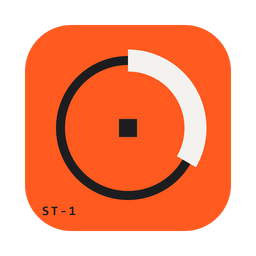
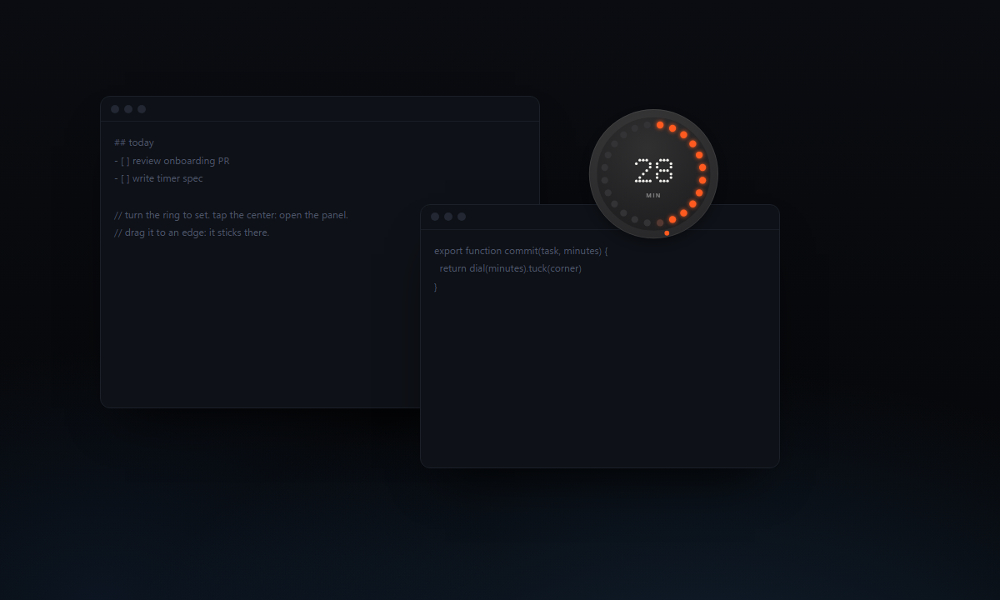
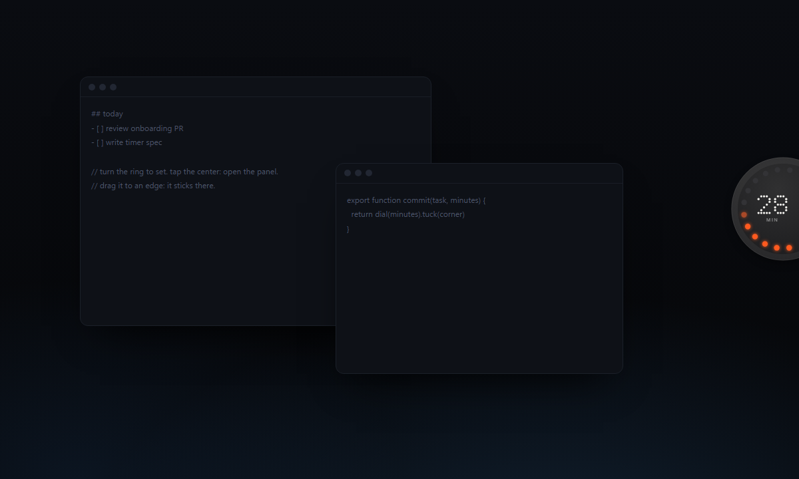
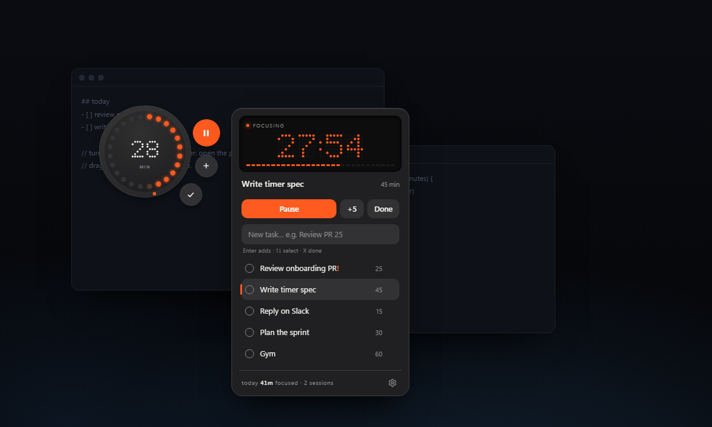
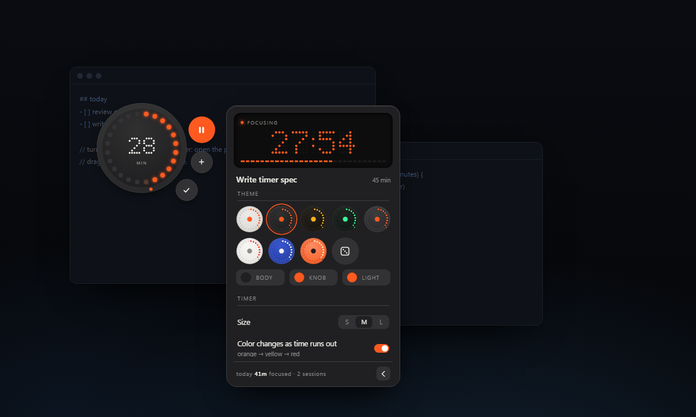

<p align="center">
  
</p>

<h1 align="center">Stick Timer</h1>

<p align="center">
  A small dial timer that floats over your work and sticks to the edge of your screen.<br>
  Turn the ring to set it, queue up tasks, and get back to work.
</p>

<p align="center">
  <a href="../../releases/latest"><b>Download for Windows &amp; macOS</b></a>
</p>

<p align="center">
  
</p>

## Features

- **A dial, not a window.** 24 LEDs count down the time. Turn the ring (or scroll) to set the minutes.
- **Sticks to the edges.** Drag it anywhere. Push it against a screen edge and it tucks in halfway; in a corner, a quarter shows. It can fade out while it's tucked.
- **Clicks go through.** Only the dial itself catches the mouse. Everything around it works as usual.
- **Task queue.** Type `Review PR 25` and press Enter to add a 25-minute task. When one ends, the next is ready.
- **Color as time runs out.** Orange, then yellow, then red.
- **Themes.** A few presets, a random one, or pick the body, knob and light colors yourself.
- **Keyboard first.** Global shortcuts to add a task, bring the dial to the center, and start or pause from any app.
- **Light.** About 40 MB of RAM and near 0% CPU when idle. The installer is ~1 MB on Windows.

<table>
  <tr>
    <td width="50%"></td>
    <td width="50%"></td>
  </tr>
  <tr>
    <td align="center">Tucked into an edge</td>
    <td align="center">Tap the center to open the task panel</td>
  </tr>
  <tr>
    <td width="50%"></td>
    <td width="50%" valign="middle">

**Using it**

- **Turn the ring** to set the time
- **Tap the center** to open the panel
- **Right-click** to start or pause
- **Drag** it anywhere; touch an edge to stick it
- A short tour shows all of this on first launch

</td>
  </tr>
  <tr>
    <td align="center">Settings and themes</td>
    <td></td>
  </tr>
</table>

## Shortcuts

| | Windows | macOS |
|---|---|---|
| New task (from any app) | `Ctrl` `Alt` `N` | `⌘` `⌥` `N` |
| Open in the center (from any app) | `Ctrl` `Alt` `K` | `⌘` `⌥` `K` |
| Start / pause (from any app) | `Ctrl` `Alt` `Space` | `⌘` `⌥` `P` |
| Opacity when stuck | `Ctrl` `[` / `Ctrl` `]` | `⌘` `[` / `⌘` `]` |

With the panel open: `↑` `↓` select, `Enter` start, `X` done, `Esc` close.

## Install

Get the latest build from [Releases](../../releases/latest).

**Windows:** run `Stick.Timer_x.y.z_x64-setup.exe`.

**macOS** (Apple Silicon and Intel):

1. Open the `.dmg` and drag **Stick Timer** to **Applications**.
2. Open Stick Timer. macOS says *"Stick Timer" Not Opened* because the app isn't notarized by Apple (that needs a paid developer account). Click **Done**.
3. Open **System Settings › Privacy & Security** and scroll down to **Security**. You'll see *"Stick Timer" was blocked to protect your Mac*. Click **Open Anyway**. The button shows for about an hour after step 2.
4. Enter your password, then click **Open Anyway** again.

You only do this once. After that it opens normally. Apple explains this in [Open a Mac app from an unknown developer](https://support.apple.com/guide/mac-help/mh40616/mac).

Prefer the Terminal? This does the same thing:

```sh
xattr -dr com.apple.quarantine "/Applications/Stick Timer.app"
```

## Build from source

Stick Timer is a [Tauri v2](https://tauri.app) app: a small Rust shell plus a single-file web UI. See [`desktop/README.md`](desktop/README.md) for how it works and how to build it on Windows and macOS.

## License

[MIT](LICENSE)
